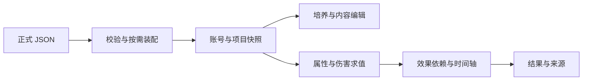

# 架构与数据流

正式 JSON 是角色、装备和公共表的维护入口。构建和开发服务直接读取这些文件并按需装配列表与实体模块，内容加载器向调用者返回独立副本。应用保存选定的培养、装备与定义引用，打开文件时恢复快照并交给求值器。

账号拥有培养、库存、展柜和穿戴；轴项目拥有队员、记录、条件和目标；内容定义库拥有可复制定义与编辑草稿。跨域操作通过明确命令传递快照，各域分别保存。

文本与计算绑定读取相同技能参数，结构化内容规则进入共同依赖图。直接查询、时间轴和独立计算器复用相同求值路径；每次运行独立装配状态，事件按确定顺序执行。

后台任务按会话、任务和修订标识接收结果，编辑使原结果失效，取消终止当前任务，迟到结果丢弃。具体职责见[模块划分](architecture.md#模块职责)，持久化规则见[文件与状态](files-and-state.md)。

## 模块职责

| 模块 | 职责 |
| --- | --- |
| 共享契约 | 身份、单位、内容、账号、项目、文件交换和任务协议；运行时校验与类型共同维护 |
| 游戏内容 | 正式实体、公共表、目录发现与按需装配 |
| 计算引擎 | 配装属性、直接伤害、效果依赖和时间轴求值 |
| 应用 | 页面、控件、纯领域操作、状态、后台任务与平台适配 |
| 测试 | 单元、集成、浏览器、桌面、性能及测试辅助 |
| 资源 | 图片、矢量、装饰、来源与分发配置 |
| 工具 | 采集、候选、生成、检查、构建、交付、清理和许可维护 |
| 文档 | 思路、规范、通用契约与工作流程 |

依赖方向为应用到引擎、契约和内容，引擎到契约，内容到契约。共享契约保持业务包独立，跨包通过公开入口导入。

应用领域操作保持响应式状态与平台独立；状态层管理持久命令，组件负责交互和布局，平台层处理原生文件及网络边界。应用运行代码、维护工具和测试分别归位。

内容维护负责定义与绑定，引擎维护负责公式和能力判定，应用维护负责编辑、确认与保存，工具维护负责来源、生成和分发。契约变更同步直接消费者及文件校验。

源代码按两空格缩进、严格类型、单引号字符串和分号维护；组件用大驼峰，函数用小驼峰，普通文件用短横线命名。具体目录见[仓库入口](../README.md)及各包说明。
