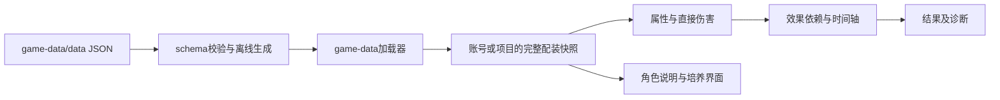

# 当前架构与数据路径

正式角色、武器和套装JSON经schema校验后生成运行分块。game-data加载器返回独立副本，web选择培养、装备和物品，将完整数值快照写入账号或项目；engine只读调用者提供的快照，不在求值时查询最新目录。

角色`talents.parameters`同时提供说明模板的值与`hits.parameter`的计算倍率。命座天赋加级使用结构化`talentBonuses`；其他未核验机制仍显示不支持。静态修饰直接保存在同一个定义内，不维护第二份角色规则表。

账号领域拥有实物、培养、展柜与穿戴；轴领域拥有队员、条件、记录和目标；内容定义库拥有可复制的定义与角色草稿。跨域操作通过明确的复制或保存命令传递快照，不共享可变物品身份。Worker按task/session/revision接受结果，取消会终止本次Worker。

文件采用第2版封装和`timeline-v1`规则；直接求值与依赖求值是显式配置，进入同一个求值器。本轮采用破坏性版本边界，旧版本文件直接拒绝，当前格式按契约校验后载入。目录、契约和持久边界分别见[仓库地图](repository-map.md)、[内容规范](../standards/content.md)与[文件规范](../standards/files-and-state.md)。
