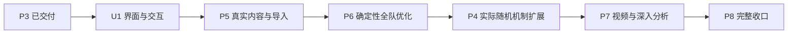

# 实施路线：先完成可用界面，再交付真实配装优化

修订日期：2026-11-06。用户在P3交付后调整优先级：现有交互不可继续作为后续工作的基础，新增独立UI阶段；P5、P6提前于P4；后续禁止使用模拟例子推进或验收。路线修订时仅重新规划；后续U1实施状态和证据见下表与U1实施记录，正式内容与优化器仍未实施。

实现基线为 `1d9e72f`，P3验收与交接提交为 `d570ac9`。P0/P1、D0/D1、P2、P2.5、P3的历史功能验收保留，见[文档导航](../README.md)。这些记录不表示当前UI体验已获认可。

## 当前顺序与状态

**U1 界面与交互重构 → P5 真实内容与导入 → P6 全队配装优化 → P4 概率扩展 → P7 视频与深入分析 → P8 完整收口。**

保留P4–P8编号用于历史引用，编号不再表示执行顺序。当前只推进U1；可运行增量与资料缺口见[U1实施记录](u1-implementation.md)，执行入口为[U1实施提示](implementation-agent-prompt.md)。U1过关后，功能主线先做P5、P6，不再把完整P4作为它们的前置。

| 阶段 | 状态 | 交付与门槛 |
| --- | --- | --- |
| P0/P1、D0/D1、P2、P2.5、P3 | 历史功能验收已完成 | 契约、账号/轴/定义边界、真实首批配装、通用效果/捕获/历史；UI体验需由U1重新验收 |
| U1 界面与交互重构 | 实施中，未通过阶段验收 | 真实操作任务、统一工作区、紧凑编辑和清晰反馈；完整走通已有真实角色与文件流程后，才能进入后续产品集成 |
| P5 真实内容与导入 | U1之后，未实施 | 一支有来源的实际队伍、实际配装/库存和实际轴，补齐该案例所需正式机制与导入；明确每项支持范围 |
| P6 全队配装优化 | P5之后，未实施 | 在P5真实项目及实际库存上选择目标、锁定、搜索、比较和采用；先交付确定性机制范围内可用的优化 |
| P4 概率扩展 | P6之后，未实施 | 针对实际案例暴露的随机机制实现严格概率、相关分支与状态期望，扩展P6支持范围 |
| P7 视频与深入分析 | P4之后，未实施 | 在同一真实队伍/素材上补视频定位、多轮标注、快捷键及深入分析；基础可用性和必要优化结果比较已在U1/P6完成 |
| P8 完整收口 | 最后，未实施 | 真实项目跨模块回归、升级预览、旧版复算与异常恢复 |

## 后续统一约束：实际案例驱动

详细证据要求见[真实案例与验收规范](real-case-validation.md)，此约束适用于U1及后续所有阶段、实施提示、演示、测试和基准。

- 不再新增虚构角色、合成Buff、任意攻击/倍率、编造库存或人工拼凑的伤害序列作为功能案例。真实角色换名字套上任意数值，也不算真实案例。
- 每项工作先确定实际游戏场景、真实角色/装备/机制、配装与记录来源，再核对独立期望，最后实施。没有资料就标记待补证据，不得编造导出、录像或实测伤害。
- 实际账号/扫描器导出与公开的可追溯玩家资料均可作为资料来源，记录出处、时间、版本、脱敏和许可。公开游戏目录不等于实际账号库存。
- 数值正确性用真实数据的独立手算/独立实现核对；声称与游戏实测一致时必须有对应观测证据。不得由待测引擎生成自己的期望。
- 错误、边界、预算测试从真实案例派生，记录改动与目的，不编造新的机制。独立搜索校验使用实际库存的明确子集，不生成假库存。压力检查保留真实项目语义，合法批量重算不得冒充长轴实战。
- 既有合成fixture和旧合成测试保留作历史兼容回归，不删除或伪装来源，也不能用它们证明新阶段完成。后续用户主流程不再以合成样本和节点操作作为入口。

## U1：界面与交互重构

**目标**：把已有计算能力整理成用户能顺畅使用的工具。本阶段必须实际改造桌面/网页共用界面，不停在截图、设计稿或增加折叠区。

**保留**：三模块的数据边界、侧栏功能分组、原神配色与凯尔特装饰、同一schema/engine、稳定ID及旧文件复算。此前认可的主题不约束现有长页面、表单堆叠和具体控件布局。

### 要解决的主要问题

1. 记录实际操作中的阻碍：入口难找、状态和保存对象不清、同页堆叠多套编辑器、滚动过长、表单顺序不符合任务、技术细节占据主流程。每项记录触发步骤、影响、对应改造和复验。
2. 工作区以当前项目和时间轴为中心。队伍/角色、记录和所选对象检查有稳定位置；顶部明确账号来源、轴、保存状态与计算状态。选中对象后只编辑该对象，避免展开整份定义和所有实例。
3. 从真实角色及技能进入建轴、添加动作/命中、查看伤害和来源；常用操作就地完成。属性捕获等以业务语言呈现，AST节点、机器ID、原始JSON和完整轨迹进入高级工具。
4. 账号角色与实物库存可筛选、查看占用、预览导入和确认转移；轴候选与账号实际装备的修改对象明确。复杂流程使用分步面板/对话框，不继续扩张主页面。
5. 保存/打开/恢复、取消和错误反馈清楚，输入校验靠近字段；切页保留上下文。危险替换要保留原资料，不能为了简化点击牺牲已有保护。
6. 为P5/P6确定内容选择、配装比较和优化任务的界面位置与交互约定；U1不假造优化结果或声称优化器已实现。搜索进度、取消、结果比较和采用的真实实现由P6交付。

### 交付与验收

- 先建立[真实案例规范](real-case-validation.md)中的U1任务和资料清单，确认任务→页面→操作→反馈；用实际案例迭代可运行界面。
- 使用现有已核验的琴、凯亚、行秋及真实装备规则检查基础数值，但不得把无圣遗物理论默认值或构造的莫娜格式样本冒充实际账号案例。实际配装/库存资料未齐的任务标记待验收。
- 用户可独立完成“准备真实资料 → 建轴 → 添技能和记录 → 改配装 → 看伤害与来源 → 保存重开”，以及库存转移、撤销/重做、恢复和错误修复。主流程不需要编辑节点、JSON、定义ID或CLI。
- 交付实际桌面和网页截图/操作记录、改造前后问题对照、任务的点击/导航/滚动情况与卡点复验；以实际任务结果评估，不用截图好看或固定测试数量代替。
- 窄屏、键盘焦点和无障碍名称可用；不出现双重滚动陷阱、横向溢出或找不到的保存反馈。保留原预算和全部兼容回归。
- 用户能实际试用并确认主要任务顺畅，U1才标完成；历史功能自动测试通过不再等价于体验验收通过。确认前先提供完整可运行改造和证据，不停在询问偏好。

**阶段出口**：`u1-implementation.md`、实际任务证据、可运行本地包和后续P5提示；未通过的任务不能靠继续堆功能绕过。

## P5：真实内容与导入

**依赖**：U1、既有P2/P3；不依赖完整P4。**范围**：为真实案例补齐内容与数据，而不是先扩充全角色目录。

1. 从用户实际使用或有公开资料的一支队伍选主案例，登记真实角色、命座、技能、武器/精炼、圣遗物实物、敌人条件、轴与来源；采用哪些案例由材料完整度和实际用途决定，不按实现方便临时拼队。
2. 先完成已确定事实下的真实直接伤害、队友效果、捕获/动态读取和该案例实际需要的机制。涉及反应、敌人阶段或其它当前缺口时，核对真实依据、补公共能力和正式定义；不能造一个简化机制顶替。
3. 以真实扫描器/莫娜导出验证单位、主副词条、实例身份、重复导入及来源更新；现有构造格式fixture只作兼容检查。线上账号接口来源未确定则单独列出未接入，不阻塞有真实文件资料的本地路径，也不冒称已联网。
4. 根据案例需要扩充敌人/阶段、武器和套装。canonical、生成快照、版本与来源一起审查；数据目录存在不等于对应机制可执行。
5. 实现P6需要的条件完整性检查：缺失事实、未支持机制、候选换装触发的依赖变化要能定位。概率机制留待P4，不能静默用平均数、默认触发或默认未触发代替。

**验收**：真实整队项目可在U1界面建成、编辑、换装和保存；每个受支持伤害及效果有独立核对，效果来源和捕获时刻可追溯。至少有一条真实队友换装影响目标角色伤害的路径。账号更新不改旧轴；资料或机制不足明确展示，不能输出完整标志。

**阶段出口**：正式案例包、实际导入文件的来源/授权记录、机制支持矩阵和独立数值核对；材料缺口不以假文件补齐。无需等待全部角色、全部接口或完整概率系统才向P6交付已核验范围。

## P6：全队配装优化（先于P4）

**依赖**：U1、P5与[莫娜调查](p0-mona-investigation.md)。**首版范围**：P5已核验的真实项目和实际库存，在明确事实与确定性机制下优化单一目标。已有经核验的固定面板单次暴击期望可继续使用，使暴击词条能够参与有实际用途的配装比较；必须证明目标中适用，不能将它扩大为非线性历史/阈值的完整概率支持。P4不是首版前置。

### 先补齐必要准入，再运行搜索

完整概率系统延期不等于取消正确性检查。P6必须自带：目标依赖完整性、候选专属机制检查、库存唯一占用、锁定、支持范围、有限数值、任务取消和预算终止。出现未确认触发或未支持随机/相关机制时，阻止相应优化任务并定位原因；不得静默丢候选再声称完整。

### 连续可用增量

1. 同一真实账号库存取一个可独立全枚举的有来源子集，保留原实物ID和原属性。逐候选人工/独立枚举核对目标、合法性与最优集合，不编造微型库存。
2. 对接固定社区莫娜算法，验证与本项目完整轴目标的等价性、全队占用和剪枝适用性。上游单人分数相加不能替代队友Buff依赖；不成立的剪枝禁用或限制范围，未接上游算法不得宣称莫娜优化已交付。
3. 扩大到该真实账号声明的实际搜索范围，交付用户界面：选择目标及允许变动角色/装备 → 设置锁定 → 看范围和准入问题 → 运行/取消 → 比较伤害、装备及效果变化 → 显式采用候选。采用候选不回写账号实际装备。
4. 理论配装能力后续可增加，但只能使用真实角色和合法真实装备参数，清楚区分于实物库存；首版不以理论输入替代实际库存闭环。

**验收**：仅选某个角色为目标时，真实队友换装带来的收益正确进入目标；同一件圣遗物不能重复占用，锁定不失效。候选重新生成效果/捕获/历史依赖，禁止只替换最终面板。结果保留项目/规则版本、目标、范围、原候选与采用候选、完成情况和可复算证据；穷举覆盖才称该范围最优，启发式和预算终止只称已找到最好结果。

**阶段出口**：可用的真实库存优化闭环、实际项目上的独立参考和算法差异报告、界面操作证据及限制；P6体验验收不推迟到P7。

## P4：真实随机机制与概率扩展（P6之后）

**依赖**：已可用的P5/P6真实案例和P3依赖模型。

- 从实际使用队伍中已核对的随机触发、相关分支、计数阈值或捕获机制选问题，记录概率来源及事件共享身份；禁止再以“两个虚构50%事件”作为阶段案例。
- 区分复盘事实与期望口径；线性解析与有限状态分支用同一真实机制的小范围独立枚举对照。不能把平均面板代入非线性捕获/历史结算。
- 扩展P6可准入范围，完整检查候选专属触发；保留确定性路径，不重做已交付搜索。
- 分支、状态、访问和时间预算明确，超限不静默近似。UI、Worker、桌面和CLI使用同一口径与版本。

**验收**：真实案例的期望、相关性和阈值可独立核对，用户可保存并复算；优化范围如何扩大明确可见。不能仅通过数学玩具例而标完成。

## P7：视频打轴与深入分析

**依赖**：U1及可用的真实配装/优化流程；计划在P4之后集中交付，不作为当前UI整改的替代阶段。

用有来源且可使用的实际录像及对应队伍资料验证时间定位、多轮标注、快捷键粗记/精调、片段复制和平移。伤害贡献、来源定位、效果修订等必要操作在此前已可用，本阶段增加深入属性收益和机制变化分析。不能用假视频、虚构命中序列或录制合成示例代替。

**验收**：用户对照实际素材完成“记录 → 校正 → 配装比较/优化 → 解释差异 → 保存 → 无视频重开”；不自动推演未标注事件，保留视频不可用时编辑能力。新增图表与收益都能追溯到真实项目和同一求值器。

## P8：完整产品回归与版本恢复

对前述真实项目执行跨模块端到端检查：资料导入、轴创作、效果、配装优化、概率口径、视频标注、取消/恢复和保存重开。真实旧项目保持原规则与结果，主动升级提供输入/规则/效果/伤害变化预览；不只保留版本字符串。

大库存、大轴和长期使用检查使用实际项目及合法范围，不能再复制任意命中拼长轴作为真实压力证据。保留旧兼容测试，但阶段完成必须由真实案例覆盖。未启用充能不强制阻塞，完整多目标和全自动战斗推演仍不属于当前主线。

## 契约、协作与验收执行

### 1.1 并行工作流

角色可按契约/内核、UI、真实内容适配、独立验证划分文件所有权；是否启用多个代理遵守当前会话权限，不将旧计划中的并行安排当成自动授权。共享schema、公共导出、Worker及根配置由一个负责人集成。真实材料调查可提前，不能跳过U1体验门槛或在资料不足时使用假案例。

每个增量都先有真实案例、来源/独立期望和最小契约，再实现同一engine和真实UI消费者；不保留第二套临时公式或假结果。旧总体/核心方案中的合成例和阶段顺序属于历史设计，本路线与[真实案例规范](real-case-validation.md)优先。

日常U1迭代按AGENTS.md最新用户要求，仅对改动主流程做必要定点检查，优先完成界面与交互。完整阶段验收再运行相关数据/素材/架构、类型、单测、构建和原预算。应用源码冻结后，实际桌面、开发浏览器、根/子路径生产浏览器按顺序运行；单worker、单套服务，禁止多套测试堆进程或按进程名批量终止用户应用。完整报告、截图、CLI与来源记录保存在本地artifacts，构建输出不提交；不push、不部署。

每阶段更新实际支持范围、材料缺口、体验验收结果及下一阶段提示。测试数量不能替代真实机制和任务验收，缺证据就如实留未完成。

## U1 当前细化范围（2026-11-06）

本轮完成紧凑账号页头、角色多条件筛选、同行三种添加入口和七元素 21 色 v1，见[设计语言](../design/visual-language.md)。用户另行明确授权的 Enka UID 公开展柜查询已作为 U1 输入交互增量接入，保存角色资料与独立快照，不增加背包实物；这是有限提前实现项，不代表 P5 已开始整队机制集成或已完成。

U1 继续待体验与真实整轴验收，顺序仍为 U1 → P5 → P6 → P4 → P7 → P8。完整 HoYoLAB 账号接口、同一实际账号展柜与莫娜实物的有证据关联、较新等级及技能映射覆盖、实际轴与机制核验继续留在后续明确范围内，不用公开示例填补用户账号的资料缺口。
