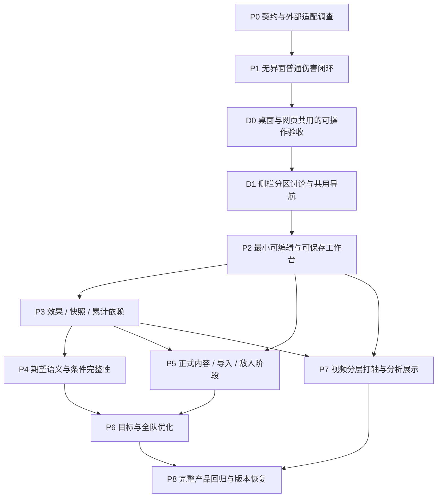

# 分层搭建与目标对齐路线

日期：2026-11-06。状态：P0/P1 无界面切片已实现；本次按用户要求调整为桌面 UI 操作优先。阶段以可验证成果划分，不承诺尚未测量的工期。具体已验证状态见 [P0/P1 记录](p0-p1-implementation.md)。

阅读：[产品目标](product-direction.md) → [总体设计](overall-design.md) → [核心代码方案](core-implementation.md) → 本路线。

来源/内容工作流可直接使用已下载的[外部参考资料](../references/README.md)，按固定提交分别研究社区莫娜算法、结构化元数据、机制文章和 Meropide 中文资料。

## 1. 搭建原则

每层必须有可运行的消费者和独立算例，不先铺空目录和抽象接口。先证明模型表达得对，再增加内容、搜索规模与交互复杂度。

用户验收以可直接打开的桌面应用和 UI 操作为主。桌面与网页共用 Vue 界面、schema 和 engine；保留 CLI 给 agent 与自动化使用。无界面内核测试通过不等于用户已经可以在程序里操作。当前优先级为 **D0：P0/P1 桌面可操作验收 → P2 完整编辑闭环 → P3 复杂机制**，不先扩充 P3 再要求用户用终端验证。D0 的工程方案、范围及检查见 [桌面实施方案](desktop-implementation.md)。

新工作台在独立命名入口逐步建设，旧模拟入口保留作当前实现和参考。新项目文件与旧 `TeamInput` 区分，不强行自动转换全部旧模拟语义。旧方案若需导入，后续提供显式、带缺失说明的适配器。

**当前追加优先项 D1**：D0 桌面验收已交付；在继续扩展 P2/P3 前，先讨论参考莫娜的侧栏导航与功能分区，再实现共用应用框架。主导航替换当前样本侧栏，样本归入示例/验收工具；切页共享项目和结果、保留编辑上下文。菜单与布局仍待讨论，见[UI 导航讨论](ui-navigation-discussion.md)。

D1 补充已确认边界：角色、圣遗物分别设栏，账号信息可保存；账号与项目独立，项目代表一条轴。实施需区分账号资源与项目快照，补充账号独立保存/读取及切换不改写旧轴的验收，不因增加侧栏而假装已接通角色接口或完成库存优化。

箭头表示正式集成与验收依赖，不要求等前一整阶段结束后才能开始所有后续工作。用户已明确要求能并行的工作并行推进；按下面的契约与文件所有权分工，允许多个开发者或代理同时工作。P0 的莫娜调查应在 P6 前完成；视频解码/时间定位风险也在 P0 做小验证。P7 随内核分批接入，避免最终才发现流程不可用。

### 1.1 并行工作流

| 工作流 | 主要所有权 | 可提前进行的工作 | 必须等待的集成条件 |
| --- | --- | --- | --- |
| A：契约与计算内核 | `src/schema/src/workbench/`、engine 的 expression/compiler/evaluation | P0 最小语义、P1 普通伤害、后续计算图能力 | 新语义先有契约样本与独立期望，再交付真实消费者 |
| B：编辑与交互 | web 的 workbench domain、stores、components、composables | P0 视频定位试验；契约发布后用固定结果样本做 P2 编辑/保存及 P7 交互 | 计算结果样本不能替代 P1/P3 真引擎；完成门槛需接入真实 Worker |
| C：来源与内容适配 | 外部参考调查、导入适配、game-data 预设与元数据 | 从 P0 开始核对社区莫娜、角色数据、机制资料、格式样本、许可；调查与视频试验无需等待内核 | 正式预设等 P3 对应公共能力；算法接入等稳定求值接口与候选约束契约 |
| D：独立验证与集成 | 合成 fixture、独立参考算例、契约兼容测试、集成检查 | 与 A 同期核算普通/快照/累计/概率样本；建立微型库存参考搜索 | 独立核算不直接调用待验证实现生成期望；集成结果需真实模块共同通过 |

所有权是一个增量期间的默认写入边界，不代表所有文件永久归某人。启动任务时指定负责人、目标、可编辑路径、契约版本和交付检查；路径冲突先拆任务，避免多方同时改公共文件。

导入适配的纯转换逻辑虽在 web domain，也归 C 负责；B 只接入其公开端口。D 的独立参考搜索放测试/fixture 或验证工具中，不另建可被产品误用的第二求值引擎。共享 `index.ts`、根配置、架构规则、schema、Worker 消息和 lockfile 由对应契约负责人统一合并，不允许各工作流自行添加不兼容版本。

### 1.2 最小契约发布与冻结

每个并行窗口只冻结本轮所需的最小契约，不预先冻结全部角色机制。契约包至少包含：

- 可解析的项目/定义/请求/结果样本及 schema 版本；区分可编辑、可求值、可优化三种状态。
- 普通、快照或累计等本轮行为样本，带独立数值期望、来源明细和错误/未知样本。
- 稳定 ID、时间及同刻顺序、单位、版本、诊断代码和人工修订定位方式。
- 公开端口的输入/输出与取消行为；未完成能力明确列出，不能靠临时字段猜测。

建议将合成项目与期望分开放在 `fixtures/workbench/`，契约兼容测试随对应模块 colocate；真实外部样本应记录来源、版本与许可。C 的原始参考 checkout 留在被 Git 忽略的本地参考区，不能成为测试或构建的隐式依赖；需要的最小样本经核对后进入仓库。

契约负责人发布一个已通过结构校验与契约测试的基线提交/修订号。B、C 可以用它建立确定性的测试替身和适配实现，但替身必须由固定样本驱动，不自行补写伤害/Buff 公式。集成验收关闭替身后再运行；“界面能演示”不等于机制通过。

发现契约不足时先提交变更说明，列出受影响消费者、样本和迁移方式，再由负责人一次更新并通知各工作流。兼容扩展也要验证未知值与旧样本；破坏性变更必须同步消费者，不保留多套临时协议并行漂移。

### 1.3 并行窗口与关键路径

| 窗口 | 同时推进 | 关键路径与收口 |
| --- | --- | --- |
| W0：启动 | A/D 定最小语义与三例期望；C 调查参考库/莫娜接口；B 验证视频定位 | A/D 收敛最小契约后启动内核和编辑并行；外部调查不阻塞合成数据闭环 |
| W1：第一个可运行版本 | A 做 P1；B 基于契约做 P2 编辑、仓储与 Worker 控制；C 做导入转换/元数据映射；D 做独立参考与协议测试 | 先合契约与 fixture，再合 P1，再将 B 接到真实结果，演示普通伤害保存/换装闭环 |
| W2：复杂能力 | A 做 P3 核心依赖；B 继续 P2/P7 标注与诊断界面；C 准备内容定义；D 对照边界与快照/累计样本 | 时间/来源契约稳定后，快照与历史模块可分人实现；同一编译调度入口仍由 A 统一集成 |
| W3：优化准备 | P3 后 A/D 做 P4 概率和准入；C 做 P5 正式内容与导入；B 做 P7 分析交互；搜索负责人做微型候选/约束与算法桥接试验 | 单次真实候选求值及 P4/P5 通过后才合 P6 正式搜索；试验不提前宣称支持全部规则 |
| W4：完整闭环 | P6 搜索接入、P7 展示与不同平台回归、版本恢复分别分工 | P8 统一验证真实输入、换装、分析、优化、取消、保存与旧版复算 |

P3 内的快照、累计实现可以在各自契约冻结后并行；公共属性语义、同刻顺序和循环诊断不得各写一套。P4 的小规模概率枚举参考可提前编写，但有状态期望的产品实现必须依赖已经验证的历史语义。P6 的候选生成、约束和进度协议可提前做，不能绕过真实求值与完整性检查。

每个窗口保留一个负责集成的所有者，使用独立分支/工作树或明确的文件边界。先合契约/样本，再合生产实现，再合调用方与端到端检查；共享导出/配置最后统一收口。小步合并可运行增量，避免所有分支长期等待一次大合并；未完成能力保持显式不可用，不能用永久 stub 接管正式路径。

### 1.4 并行验收与效率约束

任务交付需包含改动范围、使用的契约修订、通过的检查、尚未支持项和合并依赖。独立检查可以并行运行；schema 变更、依赖变更、共享文件合并与最终集成检查保持有序。

关键路径是“最小语义 → 正确求值 → 复杂依赖 → 候选准入 → 全队搜索”；UI、数据调查和导入不必排队等待这条链结束，但也不能修改核心数学以迁就临时接口。优先缩短等待和返工，不以增加未验证的角色特判、重复公式或降低检查门槛换速度。

## 2. P0：冻结最小语义与调查风险

**交付**：最小契约说明、能力清单和外部适配调查结论；不大规模改现有实现。

工作包括：

- 确定时间端点、同刻顺序、单位、引用身份、未知值和诊断等级的 v1 提案。
- 将总体设计的三个合成算例写成版本化 fixture，期望计算独立维护。
- 核对莫娜上游具体版本、许可、导入样本与算法接口，验证“任意轴目标 + 全队占用”的适配可行性，不能只验证单角色面板目标。
- 小验证浏览器视频定位精度、帧时间映射与无视频打开，记录可支持格式/定位能力的边界，不先承诺逐帧精准度。
- 明确旧规则兼容策略及项目保存最小内容，选择首个合成角色定义，不等待真实账号接口。

**通过条件**：没有用硬编码角色分支才能表达的基础算例；外部约束和未解决问题明确可定位。莫娜适配若不直接可用，形成桥接方案与差异，不私自放弃已确定的复用方向。

## 3. P1：无界面的普通伤害闭环

**代码层**：schema 的最小项目/定义/表达式；engine 的注册、属性绑定、基础编译和复盘求值；fixtures 的合成输入。

**交付能力**：读入一个包含轴、武器方案、自定义定义和目标的 JSON，求每个伤害点及全轴总伤害，导出结构化公式与来源。

首个增量只实现常量、输入、算术、区间效果与明确条件。目标筛选、未知状态、文件版本从此阶段就有，不先以 string 公式或 NaN 顶替。

**通过条件**：

- 普通伤害例分别得到 4400、4000、4840；选第二伤害点得到2000。
- 更换武器重新选择效果，没有沿用原武器 Buff。
- 同一输入顺序确定、每次运行状态隔离；未知条件不静默当零。
- 不加载视频、Vue 或旧模拟器即可运行。
- 同一个合成定义作为预设或用户定义时得到相同结果，不存在第二求值路径。

**本阶段不做**：大库存搜索、视频时间轴美化、完整角色库。

## 4. P2：最小可编辑、可保存的纵向切片

**依赖**：P1 及 D0 桌面验收入口。**代码层**：共用 UI 的 domain 编辑命令/仓储端口、Worker 协议、最小 store 和基础表格编辑；engine 项目恢复；桌面文件与窗口适配。

**交付能力**：用户无视频新建项目，编辑动作和伤害点，添加或修改一个自定义公式，切换两个配装方案，查看基本计算明细，保存并重新打开。

先用基础表单和记录列表，不以精美时间轴作为内核验收前提。把可编辑的不完整项目与可正式优化的项目状态分开。

**通过条件**：

- 撤销/重做、稳定 ID、无视频编辑以及文件往返可用。
- 用户定义可保存重开，公式与关联不丢失；属性引用与固定值不是同一字段。
- 旧结果与项目修订关联，修改后不会冒充最新结果；取消和迟到 Worker 消息不覆盖新项目。
- 保存故障/非法导入保留现有项目，不覆盖原始数据；未知条件允许保存。

这是第一条可演示闭环，完成后再扩大机制范围，而不是等所有内核开发结束才出现产品。

## 5. P3：核心效果、快照与历史依赖

**依赖**：计算上依赖 P1；当前交付顺序先完成 D0 和 P2 的可操作闭环，再通过共用界面逐步暴露 P3 能力。**代码层**：时间查询、公共效果、属性转换、图编译、修订和轨迹。

按三个连续增量搭建：

1. 同组覆盖/叠层、跨角色属性转换、自定义 Buff、候选列表与人工修订。
2. 技能/Buff 的属性级快照与动态读取混用。
3. 计数器、时间窗口累计、结算与重置；把依赖此前伤害的 Buff 也接入同一计算图。

**通过条件**：

- 快照例分别得到6900、7020、6600，变化来源可追溯。
- 累计例得到150与180，6秒端点排除、结算不含自身，故意自引用报循环。
- 效果修订在来源消失后变成待核对，不黏附到另一实例。
- 窗口、叠层和同刻边界有独立计算；目标只选累计伤害时仍保留基础命中依赖。
- 增加一种合成武器或虚构角色只需添加定义；确需新操作时增加通用操作与测试，不改目标/搜索核心。

这层完成后，模型才具备扩展真实复杂内容的基础。禁止以“角色特判先跑通”绕过通用能力验收。

## 6. P4：概率、条件完整性与优化准入

**依赖**：P3。**代码层**：期望求值、概率身份/状态、诊断与候选就绪检查。

先实现独立线性解析期望，再实现规模受控的相关分支/有限状态求值；对计数阈值、累计和快照保留所需联合信息。首批真实机制只声明已支持概率语义。

**通过条件**：

- 与独立小规模完整枚举对照；至少一次触发的两次独立50%例得到75%。
- 同一次触发的多个引用不被当成独立事件，阈值和快照例不错误代入平均数。
- 复盘与期望结果明确区分；未知反应不能被期望模式推断。
- 条件缺失时支持部分分析，正式优化检查目标依赖；只在部分候选武器触发的条件也能被发现。
- 状态/节点预算不足明确终止，不静默近似；未启用充能不因此阻塞。

这不是要求在第一版支持所有随机机制，而是保证无法正确求值时有明确能力边界。

## 7. P5：正式内容、导入和单敌人阶段

**依赖**：P2、P3；概率内容依赖 P4。**代码层**：game-data 预设、导入适配、元数据和项目定义快照。

**交付能力**：莫娜格式导入实物圣遗物，角色数据可从已确定接口或本地快照进入；接入经过核对的首批角色/武器/套装和一个多阶段敌人。

继续使用现有 canonical 输入与生成检查；新预设数据的新增来源和转换明确登记，不手改生成结果。角色接口未指定时使用已校验的本地快照，不能冒称已接通线上接口。

**通过条件**：

- 上游真实样本验证百分比单位、部位、等级、套装、重复导入和实例身份；相同属性的两件装备不被误合并。
- 一条轴切换敌人阶段时正确读取条件，并区分队伍减抗与敌人阶段，不重复计算。
- 正式与自定义内容使用相同契约；每项内容记录所需能力、依据与不支持条件。
- 换武器/套装后 Buff 候选、实际效果和公式同步变化，轴本身不被自动改写。
- 数据快照离线重开可计算，账号或数据库更新不悄悄改变旧项目。

## 8. P6：单一目标与全队配装优化

**依赖**：P4、P5 和 P0 算法研究。**代码层**：候选生成、约束检查、搜索协议、莫娜算法桥接、Worker 任务。

先建立微型全队库存的完整穷举参考实现，再接实际算法和理论参数候选。目标筛选与可变配装范围分别配置；全队唯一占用、锁定及理论边界显式校验。

**通过条件**：

- 微型库存精确搜索返回独立人工/穷举期望；算法接入对相同输入使用同一求值器。
- 只优化某人时，调整队友武器产生的 Buff 收益正确进入目标，其他角色伤害不误加到目标中。
- 实物候选不重复占用，理论候选不伪装库存；不加入少换装备等偏好。
- 候选触发未知条件、搜索未覆盖、预算终止、用户取消分别报告；不把局部最好声称为全局最优。
- 候选编译能处理武器造成的图结构改变；完成前不采用只替换面板值的错误加速。
- 结果包含目标、配置、约束、计算版本、口径及搜索完成情况，能够单独复算。

若上游搜索需要专用目标表达式转换，先以独立参考验证等价性再启用；不支持的规则明确限制算法适用范围。

## 9. P7：分层打轴与直观分析

**依赖**：P2，效果分析依赖P3，优化结果展示依赖P6。**代码层**：视频/时钟端口、编辑交互、公共分析模型与图表。

分批交付：

1. 动作/伤害/状态层切换，键盘粗记与逐帧精调，通用键及角色特殊键。
2. 队伍筛选的 Buff 面板、待确认项集中处理、来源修订及快照查询。
3. 角色/技能/时段贡献、Buff 与伤害点差异、属性增量收益与三类“溢出”解释。
4. 轴内片段复制/平移及关联修订，不与远期版本派生混为同一功能。

**通过条件**：

- 浏览器完成“对照素材分两轮标注 → 修正 → 换装 → 查看差异 → 保存 → 无视频重开”。
- 不推断反应或暴击，选填项与期望口径语义明确；标注角色切换不生成游戏切人动作。
- 每个图表数值可追到公式明细；自定义伤害不被强行解释成标准乘区。
- 属性收益基于完整重求值，能反映阈值、快照和累计变化；单位与适用范围明确。
- 视频不支持或不可用时，已保存轴仍可编辑/计算。

具体键位和视觉布局是本阶段设计工作，不在内核阶段提前锁死。

## 10. P8：完整回归与版本恢复

**依赖**：P6、P7。保存格式从 P2 已具备，此阶段验证跨模块而非最后才补保存。

**通过条件**：

- 项目离线保存、导出、重开后定义、配置、公式、目标及结果一致。
- 定义更新和求值语义更新分别测试：旧项目保持原结果，主动升级预览规则/Buff/伤害差异；不相容版本明确诊断。
- 真实内容有独立参考式，通用算例、用户自定义及微型库存搜索持续回归。
- 取消、恢复、过期结果、大库存、大轴和复杂表达式均有明确预算与验证记录。
- 用户可见的支持矩阵列出能力和规则边界，不宣称全角色/全机制支持。

性能指标基于新项目形态测量后制定，不将旧模拟器日志吞吐直接当作新求值/搜索性能保证。

## 11. 可选与远期能力

元素球记录/充能约束在核心闭环稳定后，以可选记录类型、约束构建器和面板接入。启用后有独立的收集/到达/能量算例；未启用不参与可行性判断。不要让能量模拟成为所有求值的依赖。

轴派生、多打法版本对比留作远期，不占前期主线。一般不考虑多目标，不建设全自动协同命中、受伤治疗推演或视频识别系统。

## 12. 目标对齐矩阵

| 用户目标 | 实现落点 | 验收阶段 |
| --- | --- | --- |
| 视频分层打轴、键盘粗记与精调 | 纯编辑命令、视频时钟、分层界面 | P2、P7 |
| 轴可脱离视频 | 项目/计算不依赖视频 | P1、P2、P8 |
| 换装复用轴、重新生成 Buff | 候选绑定、规则实例化、依赖编译 | P1、P3、P5、P6 |
| 内置与虚构角色共用模型 | 定义注册、受控表达式和公共操作 | P1、P3、P5 |
| 属性引用、自定义 Buff/伤害 | AST、属性依赖、定义编辑 | P2、P3 |
| 技能与 Buff 部分快照 | 属性级捕获引用、动态读取 | P3 |
| 计数与 n 秒累计伤害 | 历史展开、聚合、结算/重置 | P3 |
| 复盘及期望 | 显式口径、解析/有限状态求值 | P4 |
| 目标自定义，全队可调 | 目标闭包、变量范围和候选空间分离 | P1、P6 |
| 实际库存及理论配置 | 两种候选提供者，共用求值与约束 | P5、P6 |
| 莫娜格式与算法复用 | P0调查、导入与搜索适配器 | P0、P5、P6 |
| 敌人数据库与阶段 | 元数据定义、轴上阶段区间 | P3、P5 |
| 状态手动记录，不完整也可编辑 | 状态区间、未知状态和诊断 | P2、P3、P4 |
| 收益/乘区直观分析 | 来源轨迹、对照与增量重求值 | P1、P3、P7 |
| 快照保存与旧版复算 | 定义副本、语义版本、仓储与迁移 | P2、P5、P8 |
| 充能可选 | 独立记录与约束构建器 | 核心后可选 |
| 多打法派生 | 保留稳定项目身份与扩展边界 | 远期 |

## 13. 提交与检查方式

每个增量以一个行为闭环提交，附独立算例与适用范围；不按“先提交所有 schema，再提交所有 engine”制造长期不可运行状态。先加入输入/算例，再实现最少契约、编译和求值，最后接实际消费者。

按变更运行数据/fixture检查、架构检查、类型检查、相关单测与构建预算。UI/Worker 改动执行浏览器测试；性能敏感编译/搜索改动增加新形态的基准。已有回归继续保留，新增机制不靠复制实现的测试证明自己正确。

P0语义提案、调查记录和P1普通伤害纵向切片已交付。当前编码任务限定为 **D0 桌面可操作验收及其所需 P2 子能力**，完成后再推进完整 P2/P3。不恢复旧重构，不一次性迁移所有角色，不在语义未验证前投入大规模缓存和搜索加速。
