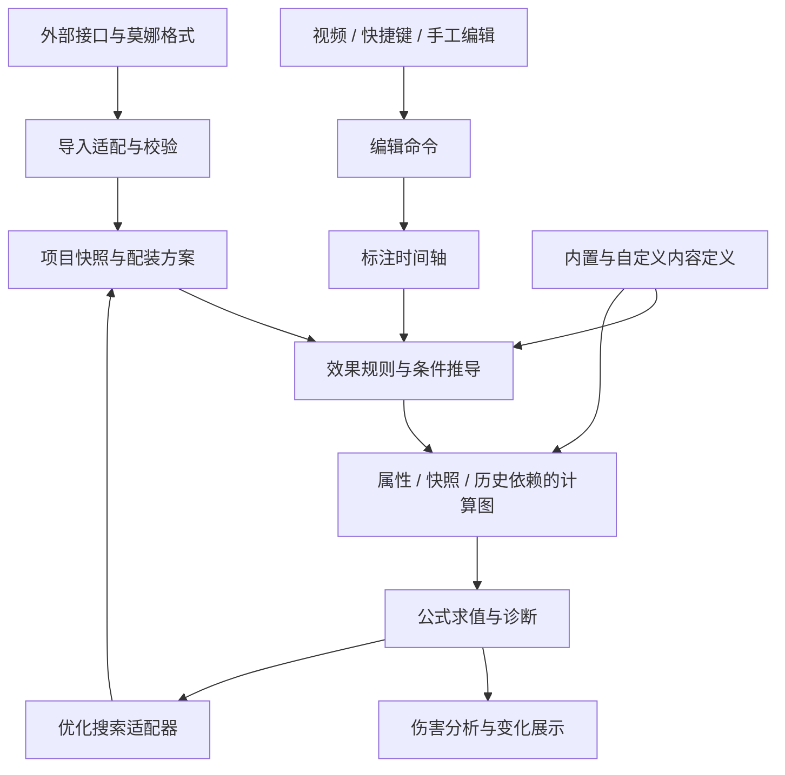

# 视频打轴与配装优化工作台：总体设计草案

日期：2026-11-06。状态：第一轮设计草案，待评审；不表示接口已定稿或功能已经实现。

[产品方向](product-direction.md)记录已确认需求，[模块原则](module-design.md)记录已认可的边界。本文将这些要求组织为可验证的设计提案；下文的对象、时间语义与求值步骤属于待验证方案，不自动视为用户已确认的细节。

具体代码落点与实现方式见[核心代码方案](core-implementation.md)，搭建依赖、交付和验收见[分层实施路线](implementation-roadmap.md)。这些是实施提案，尚未开始编码。

## 1. 系统中心与边界

中心对象是一份可独立于视频保存和使用的标注项目。用户记录动作、伤害点、状态和敌人阶段，系统据此推导效果、构建公式，并在可替换配装下求值。

不从角色动作自动生成完整战斗。规则可以计算状态依赖、计数和累计量，但不因此自动补充未标注的协同攻击、推断反应或改写时间轴。

内置和自定义角色、武器、套装、敌人尽量共用一套定义能力。内置内容是经过核验的预设，差别在来源、版本和验证状态。已有模型无法表达新机制时扩展公共能力，再由内容定义使用；不默认新增角色专属的另一套引擎。

## 2. 模块与数据流

优化箭头表示为每个候选配置调用求值，不表示修改用户保存的配装或标注。编辑状态、计算输入和搜索候选分别持有数据。

| 逻辑模块 | 输入与输出 | 边界 |
| --- | --- | --- |
| 导入适配 | 外部格式 → 已校验内部快照、来源与诊断 | 不把外部字段传播至所有业务模块 |
| 标注与编辑 | 编辑命令 → 动作、伤害点、状态、阶段等记录 | 不依赖具体快捷键，不自动推断缺失战斗事实 |
| 内容定义 | 角色、装备、敌人、效果和公式预设 | 内置与自定义使用相同定义契约 |
| 效果推导 | 记录、配置、定义 → 效果实例、条件依赖 | 候选效果与已生效效果分开 |
| 属性与公式 | 配置、效果、记录 → 带来源的计算图 | 共用快照、历史引用和单位语义 |
| 求值与诊断 | 计算图、候选输入、计算口径 → 结果、明细与问题 | 不执行任意用户代码，不静默补全未知值 |
| 优化 | 候选空间、约束、求值器 → 单一目标的搜索结果 | 不内置少换装备等隐藏偏好，不承诺启发式搜索得到全局最优 |
| 分析展示 | 求值明细、配置差异 → 贡献、乘区与收益分析 | 不在 UI 重写伤害公式 |
| 保存与版本 | 项目、定义和版本依赖 → 本地文件与恢复结果 | 不依赖视频、账号或接口持续在线 |

这些是逻辑职责，不立即新增同等数量的 workspace。现有四包边界先保留，待核心契约试验后决定模块放置；前端和外部服务适配不能进入纯计算核心。

## 3. 核心数据契约

以下是概念对象，不是最终 TypeScript 接口。

| 对象 | 保存的核心内容 | 与其他对象的关系 |
| --- | --- | --- |
| Project | schema 版本、引用清单、项目修订、可选视频关联 | 组合轴、快照、方案、目标与定义 |
| ContentDefinition | 稳定 ID、版本、来源、验证状态、属性与规则 | 内置和自定义共用；按类型定义角色、装备和敌人等 |
| Timeline | 稳定记录 ID、时间、同刻顺序、角色及类型引用 | 不保存一次求值的数值作为规则真值 |
| ActionRecord | 角色、动作类型、时刻、可选参数 | 效果与快照可引用动作 ID |
| DamageRecord | 角色、伤害定义、时刻、可选动作引用与观测条件 | 参与公式与目标筛选；观测伤害独立保存 |
| StateInterval | 对象、状态值、起止时间、来源 | 供规则读取生命比例、护盾等条件 |
| EnemyPhaseInterval | 敌人阶段定义引用、起止时间 | 阶段规则在数据库，发生时间在轴中 |
| EffectOverride | 效果来源定位、禁用或修订内容 | 独立于自动推导结果保存 |
| Configuration | 角色与武器配置、装备实例或理论属性、锁定范围 | 同一条轴可有多个候选方案 |
| Objective | 伤害筛选或自定义表达式引用、计算口径 | 默认全轴合计；不裁掉计算依赖 |
| Constraint | 合法性、库存占用、锁定及可选充能约束 | 与目标分开，显式启用可选能力 |
| CalculationArtifact | 图结构、来源映射、版本与输入签名 | 可保存和重建；不单独作为项目唯一复算依据 |

记录 ID 不随排序或插入改变。技能、Buff 和伤害类型通过定义 ID 引用，显示名称和快捷键不是关联键。

人工修订用“规则版本 + 来源记录 ID + 效果局部键”定位。来源消失或升级不兼容时将修订标为待核对，不悄悄应用到另一效果。

生命比例与绝对生命值应是不同类型，百分比与固定值也应显式区分。否则更换最大生命配装后，同一个手工数值可能被错误解释。

## 4. 定义与效果能力

内容定义声明属性、动作及伤害类型，并组合公共规则能力：条件判断、区间效果、叠层与覆盖、属性转换、快照捕获、计数和累计结算。

Buff 添加候选由当前队伍、命座、武器和套装筛选。自定义入口可以建立固定增益或属性引用表达式；出现于候选列表不代表已经触发。

规则的条件求值至少区分“满足、不满足、未知”。用户未填反应或生命状态不是 false，也不是一个默认数值。条件随候选装备改变时，必须在候选上下文重新判断。

公共求值器只接受登记的表达式操作和定义。必要的内置专用操作可以由受信任、类型化的代码注册；它必须声明依赖及版本，不向用户文件开放任意函数或脚本执行。

## 5. 时间与计算表达式提案

建议沿用整数毫秒作为项目基础单位，视频逐帧定位映射至项目时间，并保留所需素材定位信息。视频帧率与时间映射细节需另行验证。

区间建议采用 `[start, end)`。同刻不能只按数组排列碰巧决定结果：用稳定顺序与明确的读取阶段表达“效果开始前/后”“结算前/后”。例如结束时刻的快照读取何种状态，应由规则契约指定。

表达式建议覆盖以下能力：

| 能力 | 示例 | 必须声明的信息 |
| --- | --- | --- |
| 常量与输入 | 倍率、武器、词条 | 类型、单位和来源 |
| 运算与分支 | 加乘、上下限、条件选择 | 允许的操作、未知值传播 |
| 属性读取 | 角色在某时刻的攻击力 | 角色、属性、时刻与读取阶段 |
| 快照引用 | 引用施放动作捕获的攻击力 | 捕获源、属性集合、动态部分 |
| 伤害引用 | 某个已定义伤害节点 | 伤害 ID、统计口径 |
| 窗口聚合 | 过去 n 秒的伤害和 | 筛选、窗口端点、是否包含当前结算 |
| 计数与状态归约 | 命中次数、层数、清空累计 | 初值、转移、上限和先后顺序 |

有限轴上的状态归约可展开为时间顺序明确的节点，形成可检查的依赖图。引用先前值是合法历史依赖；同一属性在同一阶段互相定义、累计伤害包含自身等情况必须诊断。高级机制的合法循环若确有需求，需另立契约，不能靠重复迭代直到“看起来稳定”。

图节点保留所属记录、规则、属性来源和时间信息，数值结果与文本公式都从同一模型产生。保存时保留结构化表达式及足以重建它的轴、配置和定义；不使用无法恢复来源的一段拼接字符串作为唯一格式。

## 6. 每次求值与优化

一次候选配置求值建议经过：

1. 解析项目及定义版本，校验候选配置与装备唯一占用。
2. 绑定候选角色、武器和圣遗物，选择对应规则；效果候选依赖武器和套装时重新展开。
3. 将效果触发、数值、快照和历史累计共同编译为依赖图，合入人工修订并检查来源。
4. 从目标节点追溯依赖，诊断未确认条件、缺失引用、非法运算和循环。
5. 按复盘或期望口径求值，返回伤害、单一目标值、效果状态、来源明细与适用性提示。

推导和计算不能强行切成“先把所有 Buff 算完，再算伤害”：例如某个 Buff 依赖此前累计伤害，两者需要在同一个依赖模型中按顺序求值。

缓存按轴修订、内容/规则/求值版本、候选配置、人工修订与计算口径识别。只有依赖签名相同才可复用；换武器可能改变图结构，不能只替换面板值。先保证全量求值正确，再做增量优化。

正式优化前确认目标依赖中的未知条件。某个条件只在部分候选武器上出现时，不能漏过；相关候选需报告未就绪，不能默认为增益失效并把不完整搜索称为完整最优解。未启用充能记录不阻塞优化，也不证明充能可行。

优化形式为 `max F(x), x ∈ feasibleCandidates`。目标默认全轴总伤害，也可选择角色、技能、时段或伤害点；搜索变量可覆盖全队，锁定和候选范围另行定义。

莫娜格式通过导入适配器兼容，算法通过搜索适配器调用项目求值能力。具体上游版本、许可、输入限制、全队占用及目标函数接口待源码研究，不预设其现有算法可以直接接入或保证全局最优。是否需要跨语言/WASM 适配也尚未确定。

复盘读取标注事实。期望求值先以可证明的独立线性规则和有限状态算例验证；相关触发、阈值与快照不能普遍以平均数替代。尚无正确求值支持的规则需明确报不支持；未来若采用近似，应独立标识方法、误差依据和复现条件。

## 7. 三个独立算例验证提案

以下都是合成数据，用于检验设计，不代表真实游戏角色机制。时间使用秒便于阅读；例子明确关闭未讨论的反应、暴击和敌人减免。

### 7.1 普通伤害与候选武器效果

模板有 2 秒、6 秒两次命中，倍率均为 2。攻击力输入为 1000；候选武器 A 提供覆盖 `[0, 5)` 的 20% 伤害加成，武器 B 不提供增益，其他输入相同。

- A：`1000 × 2 × 1.2 + 1000 × 2 = 4400`。
- B：`1000 × 2 + 1000 × 2 = 4000`。
- A 的攻击力改为 1100：总伤害 `4840`。

该例验证轴结构固定、配装引发效果变化、区间读取以及贡献明细。只选第二次命中作为目标时，应得到 2000，但轴中其他记录仍然存在。

### 7.2 Buff 快照与技能属性快照混用

辅助基础攻击力 1000，在 `[0, 2)` 获得额外 500 攻击。1 秒施放一个持续至 8 秒的 Buff，将施放时自身攻击的 20% 加给输出角色，得到固定 300。输出基础攻击 2000，在 3 秒施放技能，捕获攻击力 2300；技能在 7 秒命中，倍率 2。同时有一个只在 `[6, 8)` 生效、命中时动态读取的 50% 伤害加成。

- 快照 Buff 不在 2 秒变为 200；其捕获值仍为 300。
- 命中伤害：`2300 × 2 × 1.5 = 6900`。
- 候选配装使辅助基础攻击变为 1200：重新捕获增益 `(1200 + 500) × 0.2 = 340`，伤害为 `2340 × 2 × 1.5 = 7020`。
- 若将 Buff 规则明确改为动态读取，3 秒增益为 200，技能捕获 2200，7 秒伤害为 6600。

该例验证 Buff 自身快照、技能属性快照与命中时动态乘区独立定义，并随候选配装重新计算。

### 7.3 时间窗口累计与延迟结算

轴上 1 秒造成 100、4 秒造成 200、6 秒有一次明确早于结算的普通命中 900。6 秒另有特殊伤害，规则为“过去 5 秒、窗口 `[1, 6)` 内指定角色的普通命中伤害合计 × 0.5”，且明确排除特殊结算伤害。

- 累计值为 `100 + 200 = 300`，特殊伤害为 150。
- 6 秒的普通命中虽然先执行，但被右端点排除；特殊伤害也不包含自身。
- 仅将特殊伤害作为目标时，1 秒和4秒的命中仍是计算依赖。
- 候选配装让上述两个普通命中分别变为 120 和240，特殊伤害重新求值得到180。

规则可以另行声明结算后重置，但重置影响哪个累计实例、同刻顺序必须显式定义。若将窗口改为含当前结算并允许纳入自身，应诊断循环。

### 补充验证

三例之外，还需独立测试未知条件与 false 的区别、叠层/覆盖、同刻边界、跨角色引用、手工修订失效、装备唯一占用、版本恢复及概率相关性。例如两次独立 50% 事件“至少一次触发”的概率是 75%，不能用平均触发次数 1 代替概率判断。

## 8. 分析、保存与版本

分析直接使用图的来源映射，展示角色/技能/时段贡献、候选 Buff 差异及属性增量对目标的收益。区分硬上限、条件无效和边际收益降低，不在界面增加另一套公式。

可保存文件包含轴、角色与装备快照、定义版本、用户定义、修订、目标和可选约束；视频是可选外部关联。自动生成效果与数值缓存是可重建派生物，不覆盖人工记录。

旧项目复算需具备原始定义及相容的表达式求值语义。草案建议保存实际使用的定义副本及语义版本，应用按版本选择求值器；受信任专用操作也需可恢复。无法提供相容语义时应明确阻止精确复算或引导显式升级，不能只替换成最新规则。

主动升级先生成预览，对比规则、效果和伤害，确认后更新项目依据。旧语义支持周期、文件体积和迁移策略仍待评估，不宣称仅靠保存 JSON 就可以永久恢复任意旧代码。

## 9. 前期重点、可选能力与远期

| 层次 | 范围 |
| --- | --- |
| 核心架构验证 | 三个契约、共享表达式、来源与未知状态、快照、累计依赖、自定义与内置共用定义 |
| 前期产品闭环提案 | 单敌人、基本分层标注、无视频使用、基本自动/手工 Buff、公式保存、配装求值与优化接入、基础分析、本地项目与版本 |
| 核心能力逐项落实 | 用独立算例增加机制和概率支持，不将复杂快照、计数器、自定义公式排除为永远不支持；每项明确能力边界 |
| 可选辅助 | 元素球记录与充能约束，不强制开启 |
| 远期已确认 | 轴派生、多打法版本对比 |
| 非常规目标 | 多目标、完整自动战斗推演、动作或反应自动识别 |

片段复制属于轴内编辑，不等同远期的派生版本功能。具体交付拆分需在算例和算法适配调查后确认；本表不是已经批准的排期。

## 10. 现有代码复用评估

优先检查并保留独立数学公式、配装解析、数据校验、Worker 取消与任务隔离等能力。现有 Buff、反应与调度实现作为语义参考，以新算例逐项验证后决定适配或替换。

不因已有 `simulateCombat` 和角色运行回调，就让新系统依赖其自动命中、协同触发或资源推演；不恢复已回退的角色拆分重构。现有包依赖和确定性要求仍适用，新的求值代码需要独立回归依据。

## 11. 下一轮需要解决的问题

技术调查可以先进行，不要求用户提前回答所有字段细节：

1. 形成最小版本的项目、效果定义与表达式 schema，以三例验证可表达性和诊断能力。
2. 研究莫娜源码的具体版本、格式、算法接口与许可，验证自定义目标及全队约束适配，报告性能与最优性限制。
3. 比较表达式求值、状态展开与缓存方案，验证复杂概率的支持边界和旧语义恢复成本。

确需用户后续决定的产品边界集中为：角色接口的具体来源、理论配置的合法性范围，以及基础闭环验证后首批支持哪些角色和装备。键位、图表和多段打点等 UI 细节另行设计，不阻塞当前建模讨论。
